# Rewards 面板

Rewards 面板是基于开源项目 Microsoft-Rewards-Script 的可视化面板，用于管理 Microsoft Rewards 账号、查看积分和日志、配置任务及安排定时运行。Windows 使用桌面窗口，Linux 和 Docker 使用本地浏览器访问。[Microsoft-Rewards-Script](https://github.com/TheNetsky/Microsoft-Rewards-Script)

Windows 版提供[三种参与模式](#三种参与模式)，可以按自己的习惯切换。

## 下载 Windows x64 轻量便携版

**[下载 Rewards Panel v0.1.20 轻量便携包（约 76 MiB）](https://github.com/Shmi11y/Rewards-Panel/releases/download/v0.1.20/RewardsPanel-windows-x64-lite.zip)**

1. 将 ZIP 完整解压到本机可写入的目录，打开 `RewardsPanel` 文件夹。
2. 双击带项目图标的 **`Rewards.exe`**。
3. **首次启动请保持联网。** 已有 WebView2 会直接复用，缺少时会自动下载到软件目录。使用 WebView2 正常启动时，备用 Chromium 可在「参与模式」按需下载。

下载失败时，点击「重试」重新尝试，或点击「打开日志」查看解压目录中的 `logs/launcher.log`。

Python 和 Node.js 已随包提供。

## 三种参与模式

在侧边栏的「参与模式」选择或切换。Windows 版打开 Rewards 时默认跟随系统，也可指定 Edge、Chrome 或按需下载备用 Chromium。

以下截图使用演示账号和模拟数据。

### 手动模式

从总览点「打开 Rewards」，在浏览器里自己完成活动。面板负责显示余额、积分趋势和账号状态，也可以按计划提醒你。Linux 和 Docker 版的提醒显示在面板通知中。

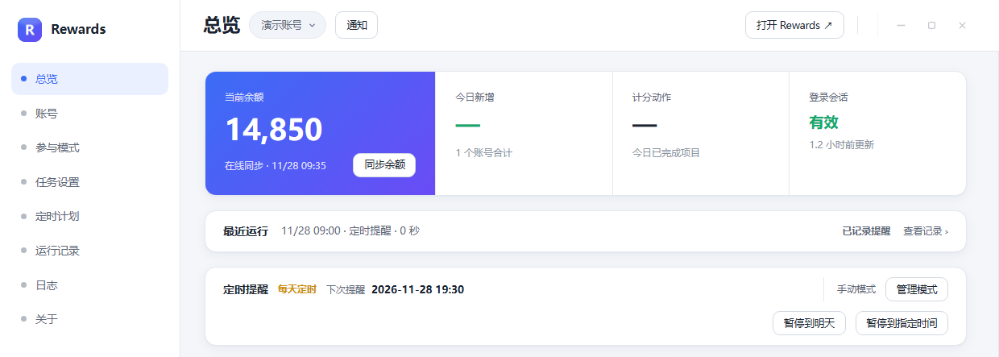

### 全自动模式

在「账号 → 添加账号」完成登录，再到「任务设置」选择要执行的任务。之后可从总览点「开始任务」，也可设置每日定时。任务引擎使用独立的登录会话，结果可在「运行记录」查看。

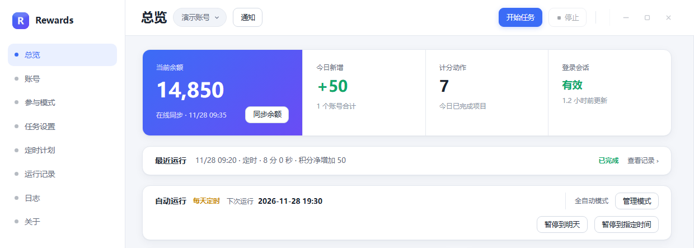

### 油猴脚本模式（Windows）

在本机 Edge 或 Chrome 里使用 Tampermonkey 和「Rewards 助手」。装好后默认从网页上的助手面板手动开始，也可开启「打开页面时自动开始」或「按现有定时计划自动开始」。页面自动启动支持必应首页和已登录的 Rewards 仪表盘。两种触发重叠时只启动一次。

启用自动启动后请保持桌面面板运行，可最小化到托盘。遇到登录失效、身份验证或计分受限时，助手会暂停并通知。到微软官网确认账号状态后，可在「参与模式」解除暂停。

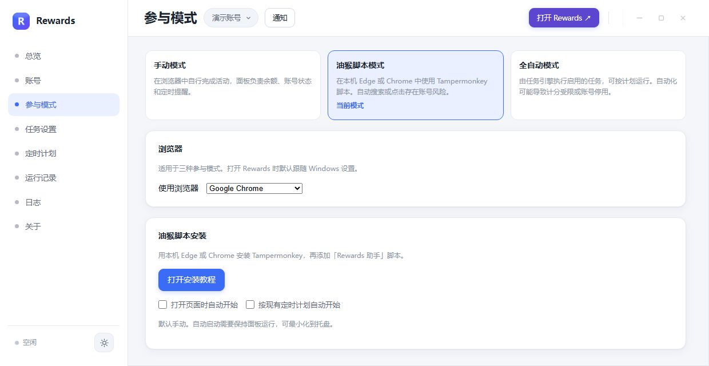

打开 Rewards 后，网页右下角会显示「Rewards 助手」。下图展示了助手在公开页面上的待机界面。

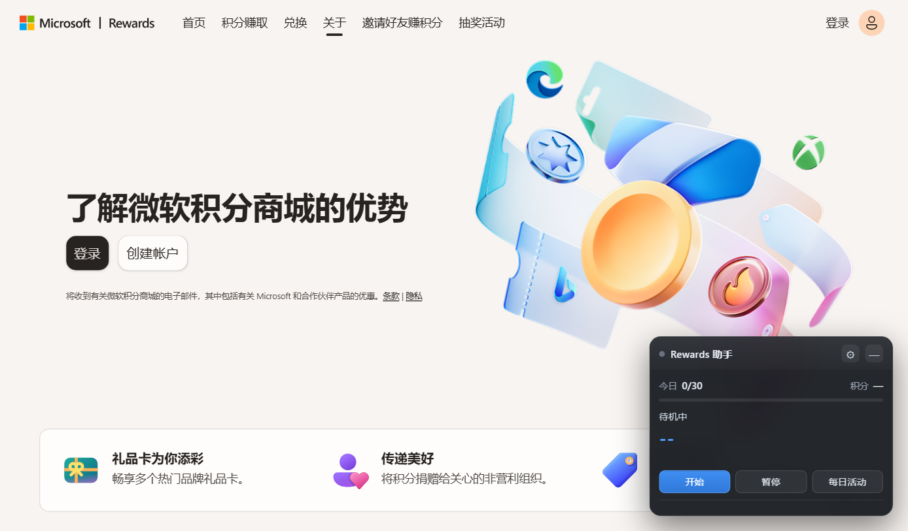

<details>
<summary>安装 Tampermonkey 和 Rewards 助手</summary>

在「参与模式」选择 Edge 或 Chrome，再点「打开安装教程」。如果 Windows 的默认浏览器已经是其中之一，也可以沿用默认设置。

1. 在教程中点击「打开官方商店」，按浏览器提示添加 Tampermonkey。 [Edge 扩展商店](https://microsoftedge.microsoft.com/addons/detail/tampermonkey/iikmkjmpaadaobahmlepeloendndfphd) · [Chrome 应用商店](https://chromewebstore.google.com/detail/tampermonkey/dhdgffkkebhmkfjojejmpbldmpobfkfo)
2. 在 Tampermonkey 的扩展详情中开启「允许运行用户脚本」。 [Tampermonkey 官方说明](https://www.tampermonkey.net/faq.php?q=Q209)
3. 保持 Rewards 面板运行，点击「复制脚本链接」。在 Tampermonkey 的「管理面板 → 实用工具 → 从 URL 安装」粘贴链接并确认。
4. 回到总览，点击「打开 Rewards」。在安装脚本的浏览器个人资料里登录微软账号，然后使用页面上的「Rewards 助手」。

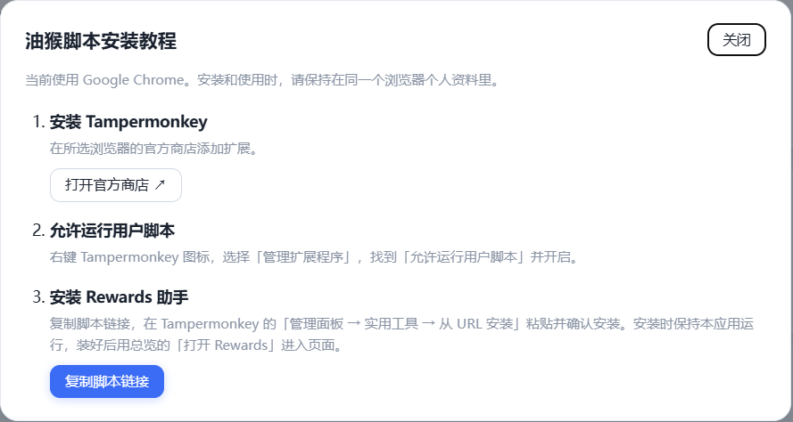

从 v0.1.19 升级后，请按教程重新导入脚本，在 Tampermonkey 中确认已更新到 1.1.0。

</details>

## Linux 与 Docker

Linux 和 Docker 版已同步至 v0.1.20，提供总览、账号管理、余额同步、手动任务、每日定时、补跑与暂停、运行记录、面板内通知和设置备份。每日定时在面板服务运行时生效。油猴脚本模式、托盘、Windows 通知、开机启动项和 EXE 一键更新适用于 Windows 桌面版。

### Linux

1. 下载并解压 [Linux x64 v0.1.20](https://github.com/Shmi11y/Rewards-Panel/releases/download/v0.1.20/RewardsPanel-linux-x64.tar.gz)。包内含任务引擎和 Chromium。推荐 Ubuntu 24.04 x64，需安装 Git、Python 3.10+、Node.js 24+ 和 npm。
2. 在解压目录运行 `bash install-linux.sh --with-deps`，补齐 Chromium 所需的系统库。此步骤需要联网，可能请求 sudo。
3. 运行 `bash launch-linux.sh`。另开终端，在相同目录执行 `cat data/.api-token`，将令牌填到 `http://127.0.0.1:8765/?k=你的令牌` 末尾后，用浏览器打开。
4. 在「账号 → 添加账号」完成首次登录。登录窗口在运行面板的 Linux 桌面上弹出，需要可用的 X11 或 XWayland 会话。已有会话后的任务可以无头运行。

更新时先退出面板、备份 `data/`，在新目录安装新版，再把原 `data/` 移过去。Windows 版的 DPAPI 密码无法跨系统解密。跨平台迁移请用「设置备份」，再重新登录账号。

### Docker

Docker 版在容器内运行面板和 Chromium。账号、会话、设置、定时计划和日志保存在 Compose 的 `rewards-data` 命名卷中。

1. 从 [v0.1.20 源码包](https://github.com/Shmi11y/Rewards-Panel/archive/refs/tags/v0.1.20.tar.gz) 解出 `compose.yaml`。将 [Docker amd64 v0.1.20 镜像包](https://github.com/Shmi11y/Rewards-Panel/releases/download/v0.1.20/RewardsPanel-docker-amd64.tar.gz) 放在同一目录，然后执行以下命令。

   ```sh
   docker load -i RewardsPanel-docker-amd64.tar.gz
   docker tag rewards-panel:0.1.20 rewards-panel:local
   docker compose up -d --no-build
   ```

2. 执行 `docker compose exec -T rewards cat /opt/rewards/data/.api-token` 取得令牌，打开 `http://127.0.0.1:8765/?k=你的令牌`。面板与登录端口默认仅映射到宿主机本地。远端服务器上请使用 SSH 端口转发访问。
3. 首次登录账号时，在终端执行 `docker compose exec rewards x11vnc -storepasswd` 设置 VNC 密码。然后执行 `docker compose exec rewards x11vnc -display :99 -rfbport 5900 -usepw -once`，用 VNC 客户端连接 `127.0.0.1:5900`。回到面板点「添加账号」或「重新登录」，在 VNC 窗口里完成登录。断开连接后 VNC 服务退出。后续仅需登录时再启动 VNC。

也可完整解压源码包，运行 `docker compose up -d --build` 自行构建。升级前结束任务，在原 Compose 目录加载并启动新版镜像，以继续使用现有数据卷。请勿使用 `docker compose down -v` 或删除数据卷。Linux 与 Docker 的数据目录依赖系统文件权限保护，账号会话应按敏感数据保管。

## 从旧版覆盖升级

**v0.1.15 及更旧版本请按下列步骤手动覆盖升级。** 从 v0.1.16 开始，后续版本可在「关于」下载并校验新版 ZIP，再点「一键更新并重启」。

1. 结束正在运行的任务并退出 Rewards。如果窗口关闭后仍留在托盘，右键点击托盘图标并选择「退出程序」。若启用了每天定时，还要停止定时守护。在 Windows 任务管理器的「详细信息」中显示「命令行」列，只结束命令行指向当前 Rewards 安装目录下 `scheduler.py` 的进程。先结束未带 `--worker` 的守护进程，再结束仍在运行的 `--worker` 进程，避免旧版占用运行库。
2. 下载上方的新版 ZIP 并完整解压。将新版 `RewardsPanel` 文件夹内的文件覆盖到原来包含 `Rewards.exe` 的目录，**保留原目录的 `data/`**。账号、登录会话、设置和定时计划都保存在这里。
3. 双击原目录里的 `Rewards.exe`，在「关于」确认便携版版本。回到总览检查「自动运行」。若每日定时已启用且提示守护未运行，点击「恢复定时」，然后核对下次运行时间。原计划若处于暂停状态，可先核对暂停截止时间。

**v0.1.14 → v0.1.15 隔离测试结果**。旧版守护仍运行时占用了 Python 运行库，停止守护后覆盖成功。启动新版 `Rewards.exe` 正常打开 WebView2 桌面面板。两个测试账号、桌面端和移动端的模拟登录会话、界面与任务设置、每日计划及补跑规则均保留。核对的 7 个数据文件在覆盖前后逐字节一致。恢复定时守护后，总览正确显示下次运行时间。真实微软会话的在线有效性未测试。

**v0.1.8 → v0.1.9 隔离测试结果**。使用两个版本的发布包实测覆盖升级，v0.1.9 能正常打开 WebView2 面板。测试账号、桌面端和移动端的模拟登录会话、界面与任务设置、定时时间及补跑规则均保留。恢复守护进程后，首页正确显示下次运行时间。会话验证覆盖本地保存和读取，真实微软会话的在线有效性未测试。

## 界面预览

截图中的账号、积分和日志均为演示数据。展开下方各组可查看对应界面。

### 总览与运行记录

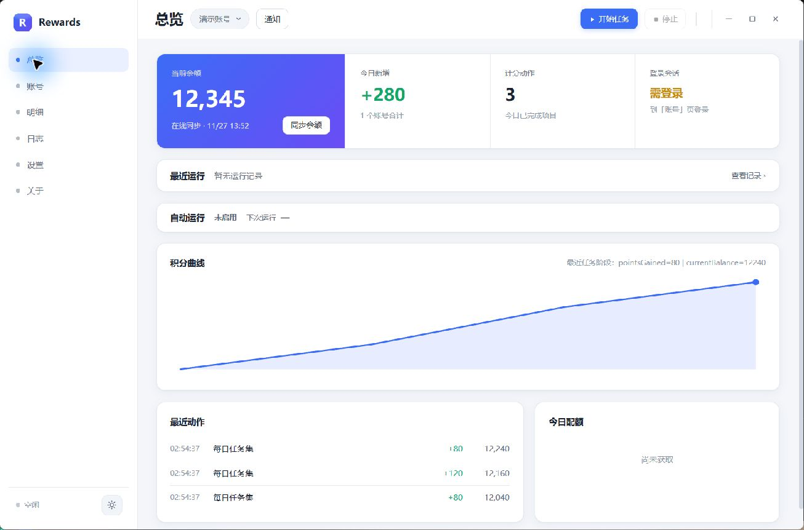

在总览可以查看当前余额、今日新增、积分走势和最近动作。顶栏提供账号切换、通知和任务控制。需要查询最新积分时，可点击余额卡片上的「同步余额」。

「同步余额」使用选中账号的已保存会话查询微软积分。余额卡片会标明来自任务日志或在线同步及其时间。任务运行时，首页显示各正在运行的账号、阶段和已完成数。有可比的成功历史时也会显示预计剩余时间。

任务发现会话失效后，首页会标出当前账号「需重新登录」，也会显示其他需要重登的启用账号数量。重新登录成功后，相关提示会清除。

首页「自动运行」显示下次运行时间和暂停状态。每天定时已启用但守护进程未运行时，会显示异常提示，并可直接点击「恢复定时」。

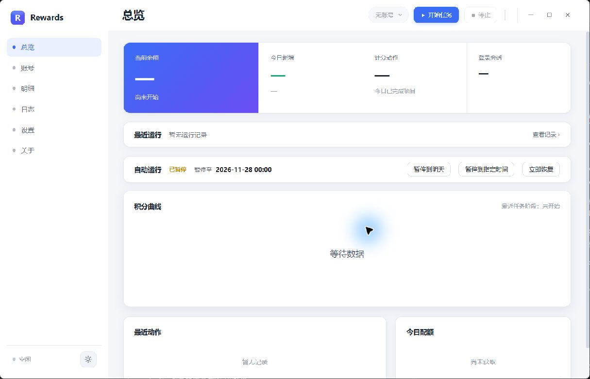

「暂停到明天」会在本机时间次日 00:00 恢复。也可选「暂停到指定时间」，或点击「立即恢复」提前结束暂停。截止时间在重启后保留，到期自动恢复，暂停期间错过的任务直接跳过。


恢复成功后，首页会重新显示下次运行时间。

<details>
<summary>深色主题与运行记录</summary>

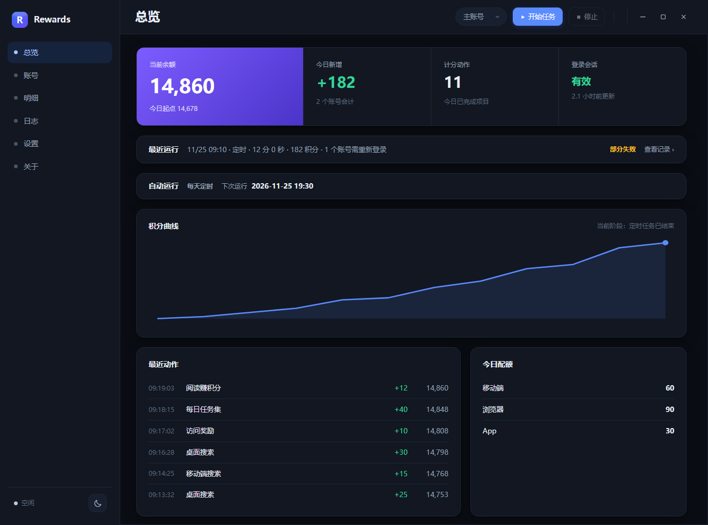

点击左下角的主题按钮，可切换浅色或深色主题。


点击首页「最近运行」查看近 7 天的手动、定时和开机任务。展开一条记录可查看各账号的结果、新增积分和本次日志。对提示需登录的账号可直接点「重新登录」，对失败账号可点「单独重试」。重试会生成一条新的手动运行记录。

运行中可展开记录查看各账号实时阶段。停止任务后，已完成账号的结果会保留。「重试失败账号」可重新运行这条记录里仍启用的失败账号。顶栏「通知」显示完成、失败、登录、更新和守护消息，可按类型选择接收，也可清空通知。

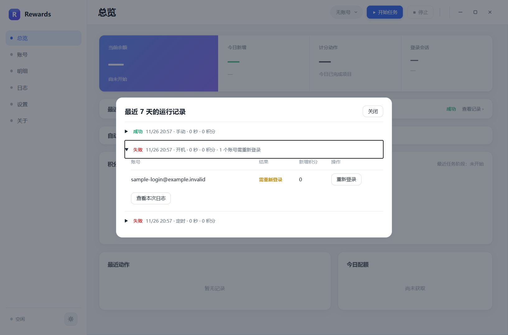

点击 Windows「运行失败」或「需要重新登录」通知的正文或「查看运行记录」按钮，可直接展开这次运行。程序留在托盘时会唤回面板。

</details>

### 账号管理

<details>
<summary>账号列表、添加、编辑与删除确认</summary>

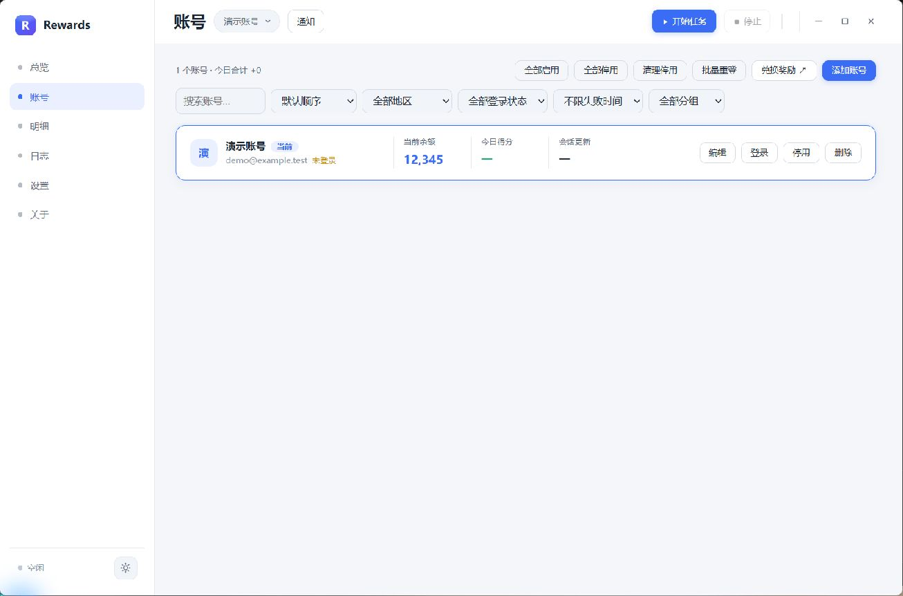

每张卡片显示该账号的余额、今日得分、登录状态和会话更新时间。可在这里切换当前账号、重新登录或启停账号，也可批量管理。点击账号页的「兑换奖励」会打开微软官方兑换页，兑换使用浏览器里已登录的微软账号。

账号页可直接搜索和排序。展开「筛选」可按地区、登录状态、分组和最近失败时间筛选。「批量操作」提供批量启停、清理停用账号和批量重登。自动任务模式下，可在账号编辑页设置分组，再到「定时计划」为每天的时间点选分组。分组栏留空会运行全部启用账号。

看到「需重新登录」时，可以直接在对应的账号卡片点击「重新登录」。登录成功后，卡片会显示「已登录」。

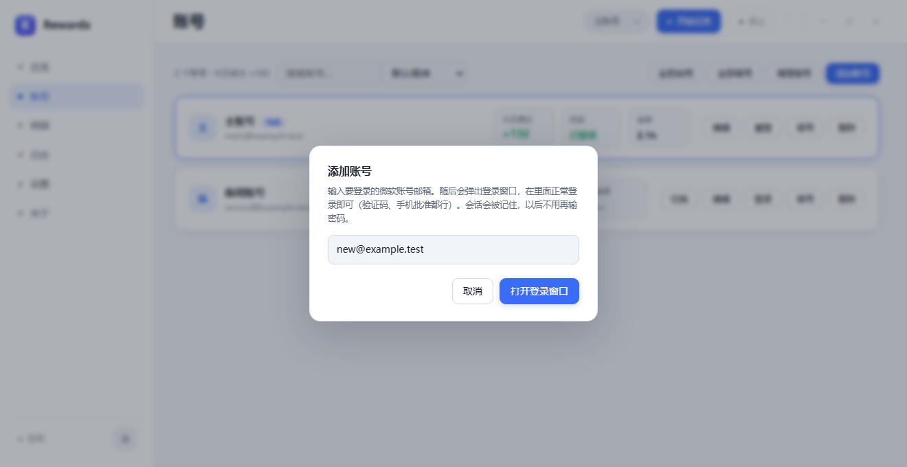

点击「添加账号」后输入微软账号邮箱，再通过打开的登录窗口完成登录。程序会保存登录会话，供后续任务使用。


点击卡片上的「编辑」可设置别名、地区和语言，并管理该账号的其他选项。密钥字段留空会沿用原值。

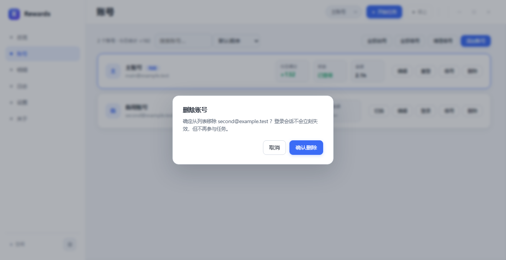

点击「删除」后，确认框会先显示要移除的账号。确认后，该账号会从列表移除并退出后续任务。

</details>

### 积分明细与日志

<details>
<summary>积分明细、异常摘要与运行日志</summary>


按活动名称搜索，或勾选「只看有积分的」，快速找到得分记录。可导出 CSV，页面底部也能查看异常摘要。


按账号、级别或关键词筛选。排查问题时可暂停自动跟随，也可把日志导出为文本文件。

</details>

### 设置

<details>
<summary>任务、节奏与运行、托盘模式、自动运行</summary>


先选「省心」「标准」或「全都要」，再按需要调整各项任务。点「保存设置」应用选项。


在「节奏与运行」可调整搜索节奏、无头模式和并发数。Windows 浏览器选项位于「参与模式」。添加账号和重新登录时会打开浏览器窗口。首次点击窗口右上角的 X，可以选择「最小化到托盘」或「退出程序」，默认选项为最小化到托盘。选择会被记住，也可在「节奏与运行 → 窗口」修改。留在托盘时当前任务继续运行，可右键选择「打开面板」或「退出程序」。


在 Windows 通知区域右键 Rewards 图标，可查看下次运行或暂停截止时间，选择暂停到明天、暂停到指定时间或立即恢复。「暂停到指定时间」会打开面板里的时间选择框。也可从菜单打开面板或退出程序。


选择手动、每天定时或开机运行。每天定时支持多个时间点、仅工作日和失败重试。关机或休眠错过定时时，可以在时限内补最近一次，也可以直接跳过。处理结果会显示在运行记录里。

每天定时的守护进程异常退出后会自动退避重启。连续三次异常时会有通知，原因和重启次数写入 `logs/scheduler.log`。旧的每日任务日志会压缩并保留 30 天。

</details>

### 关于、检查更新、设置备份与诊断报告

<details>
<summary>版本、更新下载、设置备份与诊断报告</summary>


「关于」分别显示便携版与任务引擎的版本。点击「检查更新」可查看新版摘要，下载 Windows x64 ZIP 时会显示进度。SHA-256 校验通过并创建恢复点后，可点击「一键更新并重启」。更新会退出面板、停止定时守护、保留 `data/` 并打开新版。每日定时会按原计划启动守护，已暂停的计划保留暂停状态和截止时间。下载目录仍可用于手动覆盖升级。若有任务或账号登录正在进行，请先等待完成。

点击同卡片中的「GitHub」按钮可打开最新发布页。

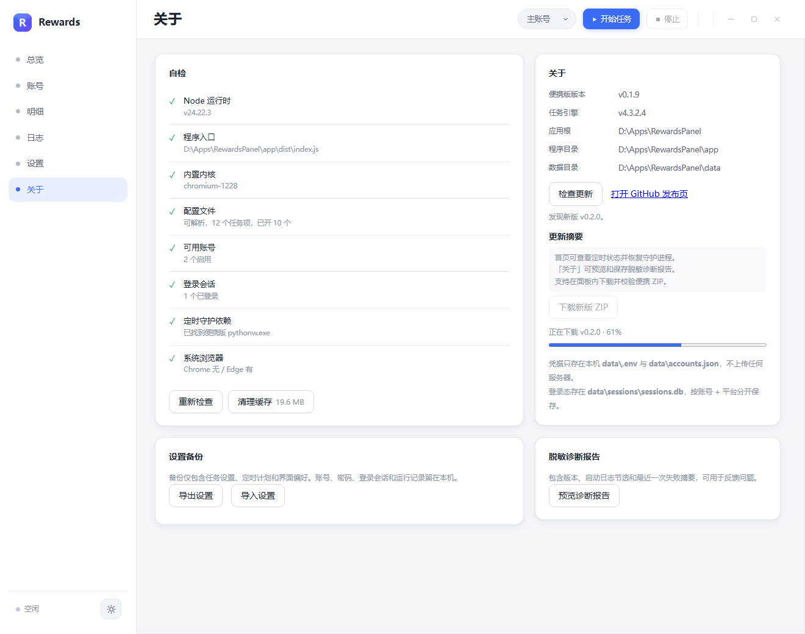

下载进度和校验结果会显示在「关于」页。校验成功后会出现「打开下载目录」和升级步骤。

在便携版里下载更新时，程序会尝试备份将被覆盖的程序文件。在页面确认恢复点已创建后再覆盖解压。新版启动失败时，退出 Rewards 及其定时守护，双击目录里的 `Restore-Previous.exe` 恢复上一版程序文件。账号和会话仍保存在 `data/`，版本变更和恢复记录可在「关于」查看。

「导出设置」保存 JSON 备份，只包含任务设置、定时计划和界面偏好。账号、密码、登录会话和运行记录留在本机。「导入设置」会在确认后覆盖备份中的设置，并按导入后的计划配置自动运行。

启动或登录遇到问题时，可在这里检查 Node、浏览器内核、配置和登录会话，也可以查看应用目录或清理缓存。

反馈问题前，可以在「关于」预览并保存脱敏诊断报告。报告包含版本、启动日志节选和最近一次运行失败摘要，可手动附到 GitHub Issue。

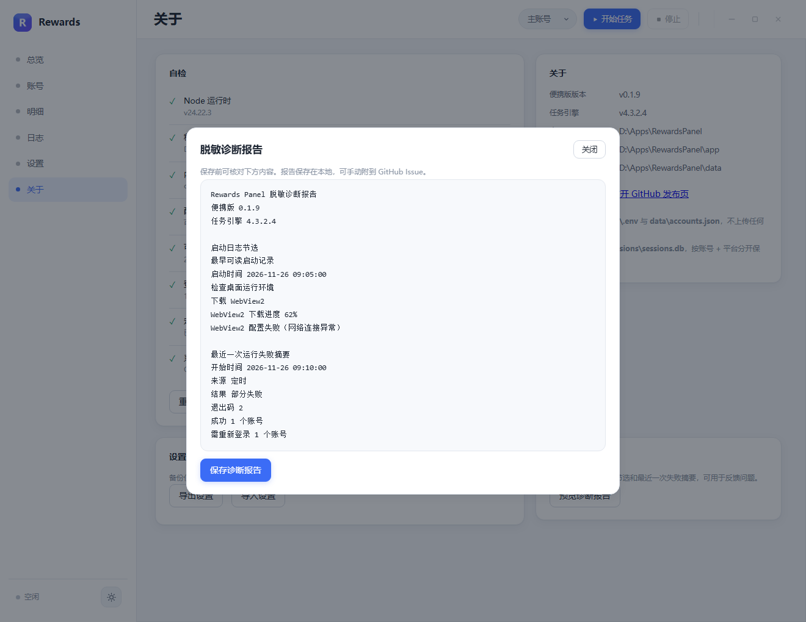

保存前可以核对报告正文。导出文件为 TXT，可手动附到问题反馈。

</details>

### 首次启动和失败处理

<details>
<summary>下载进度、重试与日志</summary>

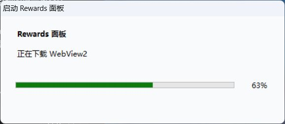

首次联网启动时，窗口会显示正在下载的组件和百分比。下载和配置完成后会进入面板。


恢复联网后可点击「重试」，也可点击「打开日志」查看失败原因。遇到 WebView2 配置失败时，还能选择用 Chromium 打开面板。

</details>

## 特性

- **总览**：余额、今日新增、动作数、积分曲线、最近动作、今日配额，2.5 秒自动刷新
- **余额与状态刷新**：余额优先读取最新日志，没有当天记录时回退到最近一次有效余额；顶栏可手动刷新账号状态
- **任务完成提示**：任务完成后显示应用内提示，并通过 Windows 通知报告完成结果和新增积分
- **运行记录**：查看近 7 天的任务及各账号的结果，直接打开本次日志、重新登录或单独重试失败账号
- **Windows 异常提醒**：任务失败或账号需要重新登录时发出通知，点击通知可直达对应运行记录
- **更新下载与设置备份**：查看更新摘要、下载并校验新版 ZIP，以及导入或导出任务设置、定时计划和界面偏好
- **脱敏诊断报告**：预览并保存版本、启动日志节选和最近一次失败摘要
- **账号管理**：多账号增删改、切换当前、单独重登、密钥脱敏显示、批量启用/停用
- **登录状态同步**：任务识别到会话失效时更新首页和账号页，重新登录成功后清除提示
- **明细**：按活动名搜索、只看有积分的、一键导出 CSV
- **日志**：按级别（错误/警告/成功）和账号过滤、关键字搜索、导出 txt
- **设置**：12 项任务开关、3 档预设（省心 / 标准 / 全都要）、5 档节奏、4 个运行选项
- **定时**：手动 / 每天 / 开机 三种模式；每天最多 4 个时间点；仅工作日；失败自动重试；错过时补跑或跳过
- **首页定时状态**：查看下次运行、暂停状态和守护进程异常，直接恢复定时
- **定时暂停**：从首页或托盘暂停到明天或指定时间，截止时间跨重启保留，到期自动恢复，可随时立即恢复
- **安全**：账号密码用 Windows DPAPI 加密存盘；本地接口需令牌；密码永不出现在接口响应里
- **体验**：首次关窗选择，默认最小化到托盘，支持深浅色主题、窗口尺寸记忆、单实例、无边框窗口

## 从源码运行

### 环境要求

- Windows 10/11 x64
- Python 3.10+，用于运行桌面面板。[Python 下载](https://www.python.org/downloads/)
- Node.js 24+，用于构建和运行上游脚本。[Node.js 下载](https://nodejs.org/) · [上游版本要求](https://github.com/huaisha1224/Microsoft-Rewards/blob/main/package.json)
- Git 和 Edge WebView2 Runtime。缺少 WebView2 时可单独安装。[WebView2 下载](https://developer.microsoft.com/microsoft-edge/webview2/#download-section)

### 1. 安装面板依赖

在 Rewards Panel 仓库根目录打开 PowerShell。

```powershell
python -m pip install -r requirements.txt
```

### 2. 准备上游脚本和 Chromium

上游源码、构建产物和 Chromium 需要在本机准备。以下命令适用于首次安装，从 Rewards Panel 仓库根目录执行。

```powershell
git clone https://github.com/huaisha1224/Microsoft-Rewards.git app
$rewardsBrowserPath = Join-Path (Get-Location).Path 'browser'
Copy-Item -LiteralPath (Get-Command node.exe -CommandType Application).Source -Destination .\app\node.exe

Push-Location .\app
npm.cmd install
npm.cmd run build
$env:PLAYWRIGHT_BROWSERS_PATH = $rewardsBrowserPath
npm.cmd run install:browser
Pop-Location
```

面板和定时调度从 `app/node.exe` 运行 `app/dist/index.js`，登录窗口使用安装到 `browser/` 的 Chromium。

### 3. 启动面板并添加账号

在仓库根目录运行以下命令，或双击 `Rewards.bat`。

```powershell
python desktop.py
```

使用全自动模式时，打开「账号 → 添加账号」，输入微软账号邮箱，在弹出的窗口完成登录。登录会话保存到本机 `data/sessions/`，账号配置由面板写入 `data/`。

## 目录结构

```
RewardsApp/
├─ desktop.py            无边框窗口外壳：单实例、几何记忆、图标、快捷方式
├─ scheduler.py          定时守护（独立进程，无窗口常驻）
├─ Rewards.bat           Windows 启动器
├─ Run-Task.bat          静默跑一次任务（开机自启脚本会调它）
├─ panel/
│  ├─ server.py          本地 HTTP 接口 + 静态服务（127.0.0.1:8765）
│  ├─ accounts.py        账号存取、DPAPI 加解密、生成 .env
│  ├─ schedule.py        定时设置：模式、多时间点、跳过今天、开机启动项
│  └─ index.html         全部界面（单文件，无框架无构建）
├─ assets/               图标（png/ico）与生成脚本
├─ docs/                 README 截图
├─ app/                  ← 上游项目，自行放置，不入库
├─ browser/              ← Patchright Chromium，Windows 桌面版按需下载，不入库
└─ data/                 ← 运行时数据，不入库
   ├─ .env               账号配置（工具读取）
   ├─ accounts.json      账号表（密码字段为 DPAPI 密文）
   ├─ sessions/          登录会话（SQLite）
   ├─ config.json        任务与节奏配置
   ├─ schedule.json      定时设置
   └─ prefs.json         界面偏好（主题、窗口尺寸）
```

## 工作原理

`desktop.py` 启动本地服务（默认 `127.0.0.1:8765`），再打开 pywebview 桌面窗口。页面定期读取运行状态，面板解析 `app/logs/` 下的任务日志，展示余额、动作与错误。

点击「开始任务」时，面板用独立 Node.js 进程运行 `app/dist/index.js`，并提供账号配置和本地数据目录。启用托盘模式后，关窗会隐藏面板并保留当前任务。退出程序时会尝试停止正在运行的任务。每日定时由后台守护进程触发，可在桌面窗口关闭时运行。

## 定时与开机自启

从侧边栏打开「定时计划」配置时间。将计划设为「手动」可关闭定时。

| 定时计划 | 手动模式 | 全自动模式 | 油猴脚本模式（Windows） |
|---|---|---|---|
| 每天 | 到点提醒 | 到点运行任务 | 开启脚本定时后打开浏览器运行，否则到点提醒 |
| 开机（Windows） | 登录后提醒 | 登录后运行任务 | 开启脚本定时后打开浏览器运行，否则登录后提醒 |

- 每天计划支持 **最多 4 个时间点**和**仅工作日**。自动任务可配置启动失败重试，提醒模式会跳过任务重试。
- 错过定时后可选择补最近一次或直接跳过。补跑时限为 1–1440 分钟，默认 720 分钟。较早的时间点和超出时限的任务会记为跳过，运行记录会显示原定时间和原因
- 主动暂停期间错过的自动任务直接跳过。恢复后从下一个有效时间点继续，仍可手动启动任务
- 「今天跳过」仅影响当天，后续日期按计划运行
- 启动项写在 `%APPDATA%\Microsoft\Windows\Start Menu\Programs\Startup`，不写注册表，不需要管理员权限

## 安全设计

| 措施 | 说明 |
|---|---|
| 密码存储 | `data/accounts.json` 中 `password` / `totp` / `proxy_pass` 用 DPAPI 加密（`enc:` 前缀），绑定当前 Windows 用户，换机器解不开 |
| 接口鉴权 | 首次启动生成 `data/.api-token`，无令牌访问 `/api/*` 返回 403；页面用 `?k=` 首次进入后落 cookie |
| 监听范围 | 只绑定 `127.0.0.1`，不接受外部连接 |
| 响应脱敏 | 账号接口用 `hasPassword` 等字段表示凭据是否存在，响应中不包含密码正文 |
| `.env` | 由 `accounts.json` 生成，供上游脚本读取，因此是明文——只放在本机 `data/` 下 |

## 本地接口

便于脚本化或自己做前端。全部需令牌。

| 方法 | 路径 | 作用 |
|---|---|---|
| GET | `/api/status` | 运行状态、余额、动作、错误、缓存体积 |
| GET | `/api/actions?limit=800` | 全量动作记录 |
| GET/POST | `/api/config` `/api/config/batch` | 读取 / 批量保存任务配置 |
| GET | `/api/accounts` | 账号列表（脱敏） |
| POST | `/api/accounts/*` | `add` `update` `remove` `switch` `toggle` `bulk` |
| GET/POST | `/api/schedule` | 读取 / 保存定时；另有 `/api/schedule/skip` |
| GET | `/api/logs?lines=800` | 日志（含级别标记） |
| POST | `/api/run` `/api/stop` | 开始 / 停止任务，可带 `{"only":"邮箱"}` 只跑一个账号 |
| GET | `/api/selftest` | 8 项环境自检 |
| POST | `/api/cache/clean` | 清理登录缓存 |
| POST | `/api/window/close` | 关闭窗口（桌面模式下可用） |

## 开发

- 后端零依赖（只用标准库），改完 `server.py` 重启即可
- 前端是单文件 `panel/index.html`，无构建步骤，改完刷新页面
- 调试接口示例：

```powershell
$k = Get-Content data\.api-token -Raw
curl "http://127.0.0.1:8765/api/status?k=$k"
```

## 许可

Rewards 面板采用 MIT 许可。[本项目许可证](LICENSE)

运行时依赖的许可声明见第三方声明。本项目随附上游 MIT 许可文本。[许可原文副本](docs/upstream-MIT-LICENSE.txt) · [第三方声明](THIRD-PARTY-NOTICES.md)

## 使用风险与免责声明

本程序仅供学习与交流，是独立的第三方项目，与微软无隶属或合作关系。使用者应遵守微软 Rewards 条款，自行判断并承担使用风险。微软可能限制计分或兑换、停用 Rewards 账号或取消积分。

- 微软规定每人只能使用一个 Rewards 账号，即使有多个邮箱也一样。每户最多六个 Rewards 账号。微软公开条款未规定共用一台设备本身会自动导致停用；家庭成员各自使用自己的账号，与同一人用多个账号赚分是两种情况。来源见 [微软服务协议的 Microsoft Rewards 一节](https://www.microsoft.com/en/servicesagreement/)。
- 微软禁止用机器人、宏或其他自动化方式赚取积分。异常暂停和零积分提示可帮助及时发现问题，无法保证账号安全。来源见 [微软 Rewards 账号政策](https://support.microsoft.com/en-us/accounts-billing/rewards/getting-the-most-out-of-microsoft-rewards)。

软件内可在「关于 → 使用风险与免责声明」查看这些说明。首次启用自动任务、保存自动定时、手动执行或重试任务，或添加第二个账号时，面板会提示风险。确认后记录在本地，重启后也不会重复提示。

