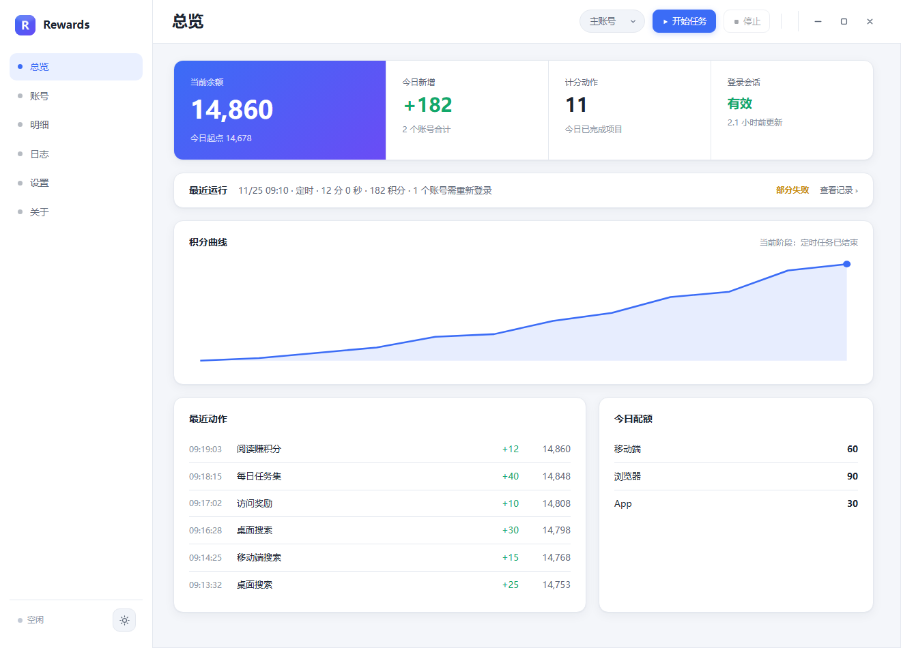

# Rewards 面板

Rewards 面板是基于开源项目 Microsoft-Rewards-Script 的 Windows 桌面 GUI，用于管理 Microsoft Rewards 账号、查看积分和日志、配置任务及安排定时运行。界面通过 pywebview 显示为本地桌面窗口。[Microsoft-Rewards-Script](https://github.com/TheNetsky/Microsoft-Rewards-Script)

## 下载 Windows x64 轻量便携版

**[下载 Rewards Panel 轻量便携包（74.7 MiB）](https://github.com/Shmi11y/rewards-panel/releases/latest/download/RewardsPanel-windows-x64-lite.zip)**

1. 将 ZIP 完整解压到本机可写入的目录，打开 `RewardsPanel` 文件夹。
2. 双击带项目图标的 **`Rewards.exe`**。
3. **首次启动请保持联网。** 程序会自动配置运行环境并下载 Chromium。已有 WebView2 会直接复用，缺少时会自动下载到软件目录。

Python 和 Node.js 已随包提供。面板打开后，在「账号 → 添加账号」完成首次登录。

| 浅色 | 深色 |
|---|---|
|  |  |


## 特性

- **总览**：余额、今日新增、动作数、积分曲线、最近动作、今日配额，2.5 秒自动刷新
- **账号管理**：多账号增删改、切换当前、单独重登、密钥脱敏显示、批量启用/停用
- **明细**：按活动名搜索、只看有积分的、一键导出 CSV
- **日志**：按级别（错误/警告/成功）和账号过滤、关键字搜索、导出 txt
- **设置**：12 项任务开关、3 档预设（省心 / 标准 / 全都要）、5 档节奏、4 个运行选项
- **定时**：手动 / 每天 / 开机 三种模式；每天最多 4 个时间点；仅工作日；失败自动重试；今天跳过
- **安全**：账号密码用 Windows DPAPI 加密存盘；本地接口需令牌；密码永不出现在接口响应里
- **体验**：深浅色主题、窗口尺寸记忆、单实例、无边框窗口、托盘残留的“Python”问题已修

## 从源码运行

### 环境要求

- Windows 10/11 x64
- Python 3.10+，用于运行桌面面板。[Python 下载](https://www.python.org/downloads/)
- Node.js 24+，用于构建和运行上游脚本。[Node.js 下载](https://nodejs.org/) · [上游版本要求](https://github.com/huaisha1224/Microsoft-Rewards/blob/main/package.json)
- Git 和 Edge WebView2 Runtime。缺少 WebView2 时可单独安装。[WebView2 下载](https://developer.microsoft.com/microsoft-edge/webview2/#download-section)

### 1. 安装面板依赖

在 Rewards Panel 仓库根目录打开 PowerShell。

```powershell
python -m pip install -r requirements.txt
```

### 2. 准备上游脚本和 Chromium

上游源码、构建产物和 Chromium 需要在本机准备。以下命令适用于首次安装，从 Rewards Panel 仓库根目录执行。

```powershell
git clone https://github.com/huaisha1224/Microsoft-Rewards.git app
$rewardsBrowserPath = Join-Path (Get-Location).Path 'browser'
Copy-Item -LiteralPath (Get-Command node.exe -CommandType Application).Source -Destination .\app\node.exe

Push-Location .\app
npm.cmd install
npm.cmd run build
$env:PLAYWRIGHT_BROWSERS_PATH = $rewardsBrowserPath
npm.cmd run install:browser
Pop-Location
```

面板和定时调度从 `app/node.exe` 运行 `app/dist/index.js`，登录窗口使用安装到 `browser/` 的 Chromium。

### 3. 启动面板并添加账号

在仓库根目录运行以下命令，或双击 `Rewards.bat`。

```powershell
python desktop.py
```

打开「账号 → 添加账号」，输入微软账号邮箱，在弹出的窗口完成登录。登录会话保存到本机 `data/sessions/`，账号配置由面板写入 `data/`。回到面板后，可在顶栏启动任务，或到「设置 → 自动运行」配置定时。

## 目录结构

```
RewardsApp/
├─ desktop.py            无边框窗口外壳：单实例、几何记忆、图标、快捷方式
├─ scheduler.py          定时守护（独立进程，无窗口常驻）
├─ Rewards.bat           Windows 启动器
├─ Run-Task.bat          静默跑一次任务（开机自启脚本会调它）
├─ panel/
│  ├─ server.py          本地 HTTP 接口 + 静态服务（127.0.0.1:8765）
│  ├─ accounts.py        账号存取、DPAPI 加解密、生成 .env
│  ├─ schedule.py        定时设置：模式、多时间点、跳过今天、开机启动项
│  └─ index.html         全部界面（单文件，无框架无构建）
├─ assets/               图标（png/ico）与生成脚本
├─ docs/                 README 截图
├─ app/                  ← 上游项目，自行放置，不入库
├─ browser/              ← Patchright Chromium，便携版首次启动自动下载，不入库
└─ data/                 ← 运行时数据，不入库
   ├─ .env               账号配置（工具读取）
   ├─ accounts.json      账号表（密码字段为 DPAPI 密文）
   ├─ sessions/          登录会话（SQLite）
   ├─ config.json        任务与节奏配置
   ├─ schedule.json      定时设置
   └─ prefs.json         界面偏好（主题、窗口尺寸）
```

## 工作原理

`desktop.py` 启动本地服务（默认 `127.0.0.1:8765`），再打开 pywebview 桌面窗口。页面定期读取运行状态，面板解析 `app/logs/` 下的任务日志，展示余额、动作与错误。

点击「开始任务」时，面板用独立 Node.js 进程运行 `app/dist/index.js`，并提供账号配置和本地数据目录。关闭桌面窗口时会尝试停止正在运行的任务。每日定时由后台守护进程触发，可在桌面窗口关闭时运行。

## 定时与开机自启

三种模式（设置 → 自动运行）：

| 模式 | 机制 |
|---|---|
| 手动 | 只在你点「开始任务」时跑 |
| 每天 | 写入启动项拉起 `scheduler.py` 常驻守护，到点触发 |
| 开机 | 写入启动项 `RewardsBoot.bat`，登录后约 1 分钟跑一次 |

- 每天模式支持 **最多 4 个时间点**、**仅工作日**、**失败重试**（触发后 3 分钟内无日志输出则重跑，可设 0-2 次）
- 「今天跳过」把今天所有时间点标记完成，明天照常
- 启动项写在 `%APPDATA%\Microsoft\Windows\Start Menu\Programs\Startup`，不写注册表，不需要管理员权限

## 安全设计

| 措施 | 说明 |
|---|---|
| 密码存储 | `data/accounts.json` 中 `password` / `totp` / `proxy_pass` 用 DPAPI 加密（`enc:` 前缀），绑定当前 Windows 用户，换机器解不开 |
| 接口鉴权 | 首次启动生成 `data/.api-token`，无令牌访问 `/api/*` 返回 403；页面用 `?k=` 首次进入后落 cookie |
| 监听范围 | 只绑定 `127.0.0.1`，不接受外部连接 |
| 响应脱敏 | 账号接口用 `hasPassword` 等字段表示凭据是否存在，响应中不包含密码正文 |
| `.env` | 由 `accounts.json` 生成，供上游脚本读取，因此是明文——只放在本机 `data/` 下 |

## 本地接口

便于脚本化或自己做前端。全部需令牌。

| 方法 | 路径 | 作用 |
|---|---|---|
| GET | `/api/status` | 运行状态、余额、动作、错误、缓存体积 |
| GET | `/api/actions?limit=800` | 全量动作记录 |
| GET/POST | `/api/config` `/api/config/batch` | 读取 / 批量保存任务配置 |
| GET | `/api/accounts` | 账号列表（脱敏） |
| POST | `/api/accounts/*` | `add` `update` `remove` `switch` `toggle` `bulk` |
| GET/POST | `/api/schedule` | 读取 / 保存定时；另有 `/api/schedule/skip` |
| GET | `/api/logs?lines=800` | 日志（含级别标记） |
| POST | `/api/run` `/api/stop` | 开始 / 停止任务，可带 `{"only":"邮箱"}` 只跑一个账号 |
| GET | `/api/selftest` | 8 项环境自检 |
| POST | `/api/cache/clean` | 清理登录缓存 |
| POST | `/api/window/close` | 关闭窗口（桌面模式下可用） |

## 常见问题

**窗口怎么拖动**：按住**顶栏空白处**拖（标题那一行）。页面其它区域不响应拖动，避免翻日志、选文字时把窗口带跑；双击顶栏最大化/还原。

**窗口启动失败**：在仓库根目录执行 `python desktop.py` 查看终端报错，并确认 Python 依赖和 WebView2 已安装。

**任务栏右键显示 “Python”**：需要 `pywin32`。程序会自动在开始菜单建带 AUMID 的快捷方式，建好后取消固定再重新固定即可。

**窗口越开越小**：已修（客户区/外框差值补偿）。若仍有偏差，删掉 `data/prefs.json` 里的 `win` 字段重开一次。

**提示“已有任务在运行”**：可能是上次异常退出留下的进程。看 `data/task.pid`，或任务管理器结束 `node.exe`。

**登录缓存占地大**：关于页有「清理缓存」按钮。

## 开发

- 后端零依赖（只用标准库），改完 `server.py` 重启即可
- 前端是单文件 `panel/index.html`，无构建步骤，改完刷新页面
- 调试接口示例：

```powershell
$k = Get-Content data\.api-token -Raw
curl "http://127.0.0.1:8765/api/status?k=$k"
```

## 许可

Rewards 面板采用 MIT 许可。[本项目许可证](LICENSE)

运行时依赖的许可声明见第三方声明。本项目随附上游 MIT 许可文本。[许可原文副本](docs/upstream-MIT-LICENSE.txt) · [第三方声明](THIRD-PARTY-NOTICES.md)

## 免责

本项目仅用于个人学习与自用自动化。使用前请自行确认符合微软奖励计划的服务条款；账号被限制、积分被清零等后果由使用者自行承担。作者不对任何间接损失负责。
