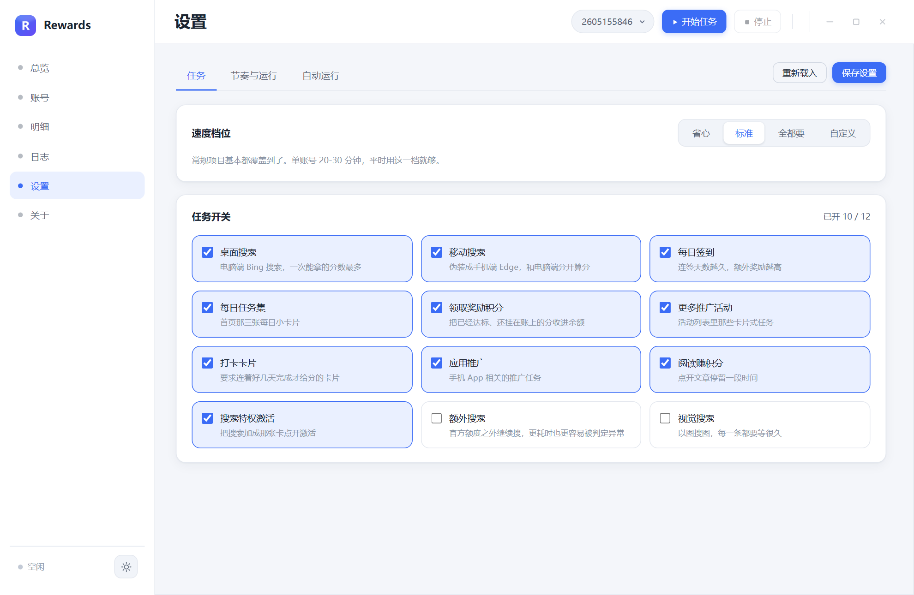

# Rewards 面板

给无人值守的微软奖励脚本配一个本地图形界面：看余额、改配置、翻日志、排定时，不用再手改配置文件。

界面是本地网页（`http://127.0.0.1:8765`），外壳用 pywebview 套成无边框桌面窗口。所有数据都在本机，不发往任何服务器。

| 浅色 | 深色 |
|---|---|
|  |  |



## 特性

- **总览**：余额、今日新增、动作数、积分曲线、最近动作、今日配额，2.5 秒自动刷新
- **账号管理**：多账号增删改、切换当前、单独重登、密钥脱敏显示、批量启用/停用
- **明细**：按活动名搜索、只看有积分的、一键导出 CSV
- **日志**：按级别（错误/警告/成功）和账号过滤、关键字搜索、导出 txt
- **设置**：12 项任务开关、3 档预设（省心 / 标准 / 全都要）、5 档节奏、4 个运行选项
- **定时**：手动 / 每天 / 开机 三种模式；每天最多 4 个时间点；仅工作日；失败自动重试；今天跳过
- **安全**：账号密码用 Windows DPAPI 加密存盘；本地接口需令牌；密码永不出现在接口响应里
- **体验**：深浅色主题、窗口尺寸记忆、单实例、无边框窗口、托盘残留的“Python”问题已修

## 与上游的关系

**本项目不含爬虫/自动化逻辑本身。** 它是上游开源项目的一个前端外壳：

| 角色 | 项目 |
|---|---|
| 自动化核心 | [huaisha1224/Microsoft-Rewards](https://github.com/huaisha1224/Microsoft-Rewards)（MIT，`Copyright (c) 2023 Sam.Huang`） |
| 本项目 | `panel/` `desktop.py` `scheduler.py` `assets/` —— Python + HTML/JS 独立实现 |

所以你需要**自己把上游放进 `app/` 目录**，本仓库不附带它的构建产物。
界面文案已全部重写；信息架构（任务分类、档位划分）参考了上游，详见 [THIRD-PARTY-NOTICES.md](THIRD-PARTY-NOTICES.md)。

## 快速开始

### 前置

- Windows 10/11
- [Python 3.10+](https://www.python.org/downloads/)（勾选 Add to PATH）
- [Node.js 20+](https://nodejs.org/)（构建上游用）

### 1. 装依赖

```powershell
pip install -r requirements.txt
```

> `pywebview` 依赖 Edge WebView2 运行时，Win10/11 一般自带；没有的话到微软官网装 “WebView2 Runtime”。

### 2. 准备运行时核心

把上游放到 `app/`：

```powershell
git clone https://github.com/huaisha1224/Microsoft-Rewards app
cd app
npm install
npm run build
cd ..
```

构建完应存在 `app/dist/index.js` 和 `app/node.exe`（没有 `node.exe` 就用系统 Node，或者在 `app/` 下放一份便携版 `node.exe`）。

### 3. 配置账号

首次启动会自动生成 `data/` 目录，点开界面「账号 → 添加账号」填邮箱密码即可。
也可以手写 `data/.env`：

```ini
ACCOUNT_1_EMAIL=you@example.com
ACCOUNT_1_PASSWORD=your-password
ACCOUNT_1_TOTP_SECRET=
ACCOUNT_1_PROXY=
```

### 4. 启动

```powershell
python desktop.py
```

或者双击 `Rewards.bat`。

## 目录结构

```
RewardsApp/
├─ desktop.py            无边框窗口外壳：单实例、几何记忆、图标、快捷方式
├─ scheduler.py          定时守护（独立进程，无窗口常驻）
├─ Rewards.bat           带控制台的启动器
├─ Run-Task.bat          静默跑一次任务（开机自启脚本会调它）
├─ panel/
│  ├─ server.py          本地 HTTP 接口 + 静态服务（127.0.0.1:8765）
│  ├─ accounts.py        账号存取、DPAPI 加解密、生成 .env
│  ├─ schedule.py        定时设置：模式、多时间点、跳过今天、开机启动项
│  └─ index.html         全部界面（单文件，无框架无构建）
├─ assets/               图标（png/ico）与生成脚本
├─ docs/                 README 截图
├─ app/                  ← 上游项目，自行放置，不入库
├─ browser/              ← Playwright Chromium，首次运行自动下载，不入库
└─ data/                 ← 运行时数据，不入库
   ├─ .env               账号配置（工具读取）
   ├─ accounts.json      账号表（密码字段为 DPAPI 密文）
   ├─ sessions/          登录会话（SQLite）
   ├─ config.json        任务与节奏配置
   ├─ schedule.json      定时设置
   └─ prefs.json         界面偏好（主题、窗口尺寸）
```

## 工作原理

```
Rewards.bat / desktop.py
   ├─ 起后端线程：panel/server.py  → 127.0.0.1:8765
   ├─ 起窗口：pywebview（无边框 + WebView2）
   └─ 页面每 2.5s GET /api/status
                 │
                 ├─ 任务在跑？→ 读 data/task.pid + 日志新鲜度判断
                 └─ 解析 app/logs/YYYY-MM-DD.log → 余额、动作、错误

点「开始任务」
   └─ gevent/无 → subprocess(node dist/index.js)
        env 注入：账号、代理、任务开关、节奏参数
        输出重定向 → 日志文件，面板只读不写
```

任务本身由上游脚本在独立进程里跑，面板不介入浏览器自动化。**关掉面板不会中断任务**，除非你在运行中手动关窗口（会先停任务）。

## 定时与开机自启

三种模式（设置 → 自动运行）：

| 模式 | 机制 |
|---|---|
| 手动 | 只在你点「开始任务」时跑 |
| 每天 | 写入启动项拉起 `scheduler.py` 常驻守护，到点触发 |
| 开机 | 写入启动项 `RewardsBoot.bat`，登录后约 1 分钟跑一次 |

- 每天模式支持 **最多 4 个时间点**、**仅工作日**、**失败重试**（触发后 3 分钟内无日志输出则重跑，可设 0-2 次）
- 「今天跳过」把今天所有时间点标记完成，明天照常
- 启动项写在 `%APPDATA%\Microsoft\Windows\Start Menu\Programs\Startup`，不写注册表，不需要管理员权限

## 安全设计

| 措施 | 说明 |
|---|---|
| 密码存储 | `data/accounts.json` 中 `password` / `totp` / `proxy_pass` 用 DPAPI 加密（`enc:` 前缀），绑定当前 Windows 用户，换机器解不开 |
| 接口鉴权 | 首次启动生成 `data/.api-token`，无令牌访问 `/api/*` 返回 403；页面用 `?k=` 首次进入后落 cookie |
| 监听范围 | 只绑定 `127.0.0.1`，不接受外部连接 |
| 响应脱敏 | 账号接口只返回 `hasPassword` 等布尔值，明文密码不出进程 |
| `.env` | 由 `accounts.json` 生成，供上游脚本读取，因此是明文——只放在本机 `data/` 下 |

## 本地接口

便于脚本化或自己做前端。全部需令牌。

| 方法 | 路径 | 作用 |
|---|---|---|
| GET | `/api/status` | 运行状态、余额、动作、错误、缓存体积 |
| GET | `/api/actions?limit=800` | 全量动作记录 |
| GET/POST | `/api/config` `/api/config/batch` | 读取 / 批量保存任务配置 |
| GET | `/api/accounts` | 账号列表（脱敏） |
| POST | `/api/accounts/*` | `add` `update` `remove` `switch` `toggle` `bulk` |
| GET/POST | `/api/schedule` | 读取 / 保存定时；另有 `/api/schedule/skip` |
| GET | `/api/logs?lines=800` | 日志（含级别标记） |
| POST | `/api/run` `/api/stop` | 开始 / 停止任务，可带 `{"only":"邮箱"}` 只跑一个账号 |
| GET | `/api/selftest` | 8 项环境自检 |
| POST | `/api/cache/clean` | 清理登录缓存 |
| POST | `/api/window/close` | 关闭窗口（桌面模式下可用） |

## 常见问题

**窗口怎么拖动**：按住**顶栏空白处**拖（标题那一行）。页面其它区域不响应拖动，避免翻日志、选文字时把窗口带跑；双击顶栏最大化/还原。

**启动弹黑框**：用 `python desktop.py` 而不是 `pythonw`，或直接用 `Rewards.bat`。

**任务栏右键显示 “Python”**：需要 `pywin32`。程序会自动在开始菜单建带 AUMID 的快捷方式，建好后取消固定再重新固定即可。

**窗口越开越小**：已修（客户区/外框差值补偿）。若仍有偏差，删掉 `data/prefs.json` 里的 `win` 字段重开一次。

**提示“已有任务在运行”**：可能是上次异常退出留下的进程。看 `data/task.pid`，或任务管理器结束 `node.exe`。

**登录缓存占地大**：关于页有「清理缓存」按钮。

## 开发

- 后端零依赖（只用标准库），改完 `server.py` 重启即可
- 前端是单文件 `panel/index.html`，无构建步骤，改完刷新页面
- 调试接口示例：

```powershell
$k = Get-Content data\.api-token -Raw
curl "http://127.0.0.1:8765/api/status?k=$k"
```

## 许可

本项目代码：MIT（见 [LICENSE](LICENSE)）。

上游 `app/`：MIT / GPL-3.0-later 声明不一致，详见 [THIRD-PARTY-NOTICES.md](THIRD-PARTY-NOTICES.md)。

## 免责

本项目仅用于个人学习与自用自动化。使用前请自行确认符合微软奖励计划的服务条款；账号被限制、积分被清零等后果由使用者自行承担。作者不对任何间接损失负责。
