# Rewards 面板

Rewards 面板是基于开源项目 Microsoft-Rewards-Script 的 Windows 桌面 GUI，用于管理 Microsoft Rewards 账号、查看积分和日志、配置任务及安排定时运行。界面通过 pywebview 显示为本地桌面窗口。[Microsoft-Rewards-Script](https://github.com/TheNetsky/Microsoft-Rewards-Script)

## 下载 Windows x64 轻量便携版

**[下载 Rewards Panel v0.1.9 轻量便携包（约 75 MiB）](https://github.com/Shmi11y/Rewards-Panel/releases/download/v0.1.9/RewardsPanel-windows-x64-lite.zip)**

1. 将 ZIP 完整解压到本机可写入的目录，打开 `RewardsPanel` 文件夹。
2. 双击带项目图标的 **`Rewards.exe`**。
3. **首次启动请保持联网。** 程序会自动配置运行环境并下载 Chromium。已有 WebView2 会直接复用，缺少时会自动下载到软件目录。窗口会显示正在下载的组件和百分比。

下载失败时，点击「重试」重新尝试，或点击「打开日志」查看解压目录中的 `logs/launcher.log`。

Python 和 Node.js 已随包提供。面板打开后，在「账号 → 添加账号」完成首次登录。

## 从 v0.1.8 覆盖升级到 v0.1.9

1. 结束正在运行的任务，然后退出 Rewards。如果窗口关闭后仍留在托盘，右键点击托盘图标并选择「退出程序」。
2. 下载上方的 v0.1.9 ZIP 并完整解压。将新版 `RewardsPanel` 文件夹内的文件覆盖到原来包含 `Rewards.exe` 的目录，**保留原目录的 `data/`**。账号、登录会话、设置和定时计划都保存在这里。
3. 双击原目录里的 `Rewards.exe`，在「关于」确认便携版版本为 v0.1.9。若首页提示定时守护未运行，点击「恢复定时」，并核对下次运行时间。

**隔离测试结果**。使用两个版本的发布包实测覆盖升级，v0.1.9 能正常打开 WebView2 面板。测试账号、桌面端和移动端的模拟登录会话、界面与任务设置、定时时间及补跑规则均保留。恢复守护进程后，首页正确显示下次运行时间。会话验证覆盖本地保存和读取，真实微软会话的在线有效性未测试。

## 界面预览

截图中的账号、积分和日志均为演示数据。展开下方各组可查看对应界面。

### 总览与运行记录


在总览可以查看当前余额、今日新增、积分走势和最近动作。顶栏可切换账号、开始或停止任务。

首页「自动运行」显示下次运行时间和暂停状态。每天定时已启用但守护进程未运行时，会显示异常提示，并可直接点击「恢复定时」。

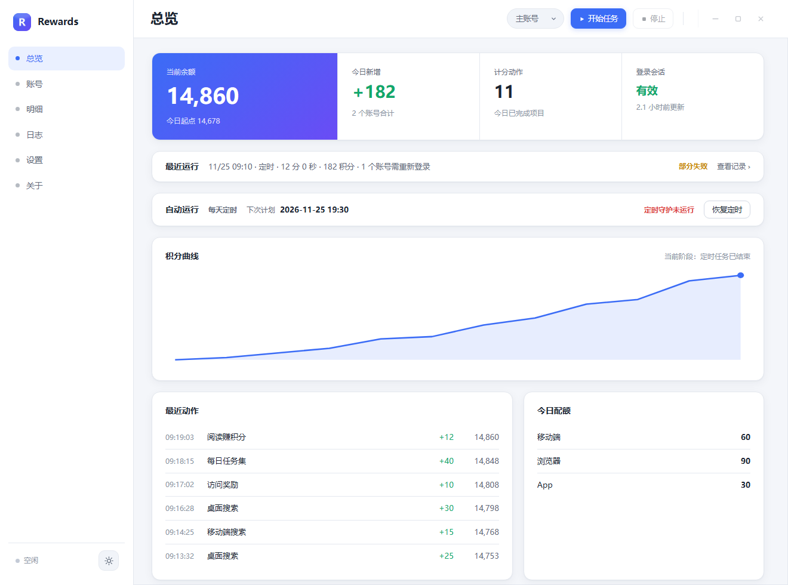

恢复成功后，首页会重新显示下次运行时间。

<details>
<summary>深色主题与运行记录</summary>


点击左下角的主题按钮，可切换浅色或深色主题。

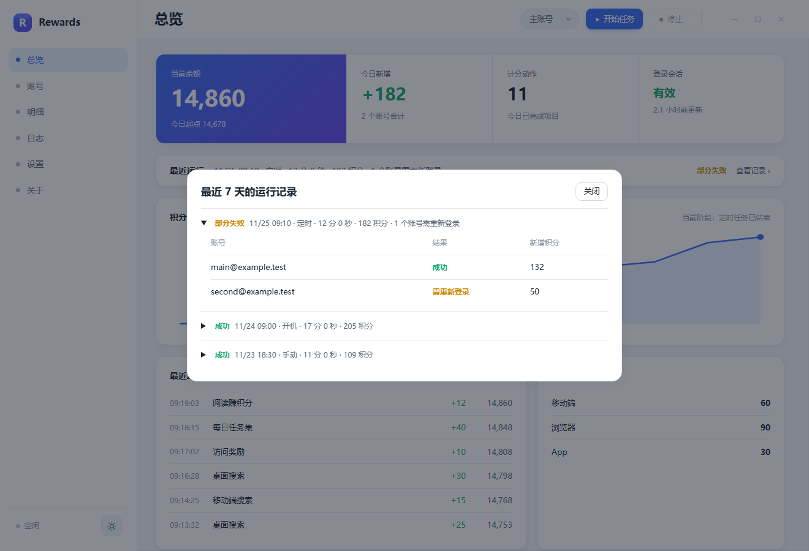

点击首页「最近运行」查看近 7 天的手动、定时和开机任务。展开一条记录可查看各账号的结果、新增积分和本次日志。对提示需登录的账号可直接点「重新登录」，对失败账号可点「单独重试」。重试会生成一条新的手动运行记录。

</details>

### 账号管理

<details>
<summary>账号列表、添加、编辑与删除确认</summary>

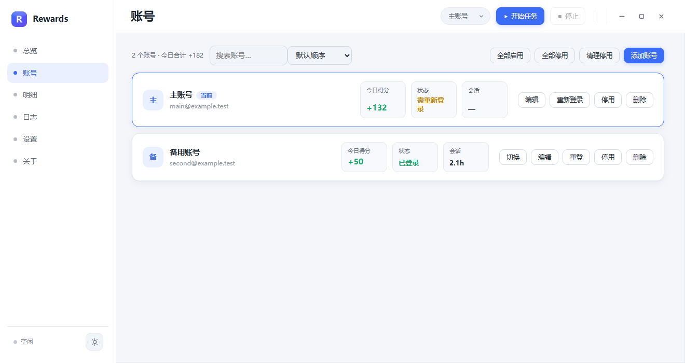

每张卡片显示该账号的登录状态、会话时间和今日得分。可在这里切换当前账号、重新登录或启停账号，也可批量管理。


点击「添加账号」后输入微软账号邮箱，再通过打开的登录窗口完成登录。程序会保存登录会话，供后续任务使用。

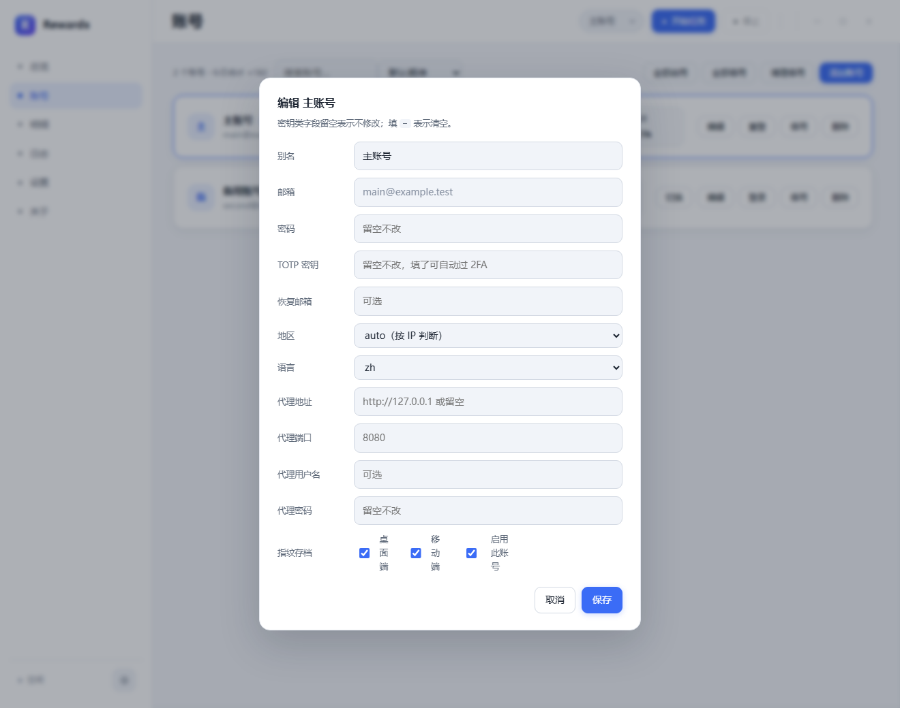

点击卡片上的「编辑」可设置别名、地区和语言，并管理该账号的其他选项。密钥字段留空会沿用原值。


点击「删除」后，确认框会先显示要移除的账号。确认后，该账号会从列表移除并退出后续任务。

</details>

### 积分明细与日志

<details>
<summary>积分明细、异常摘要与运行日志</summary>

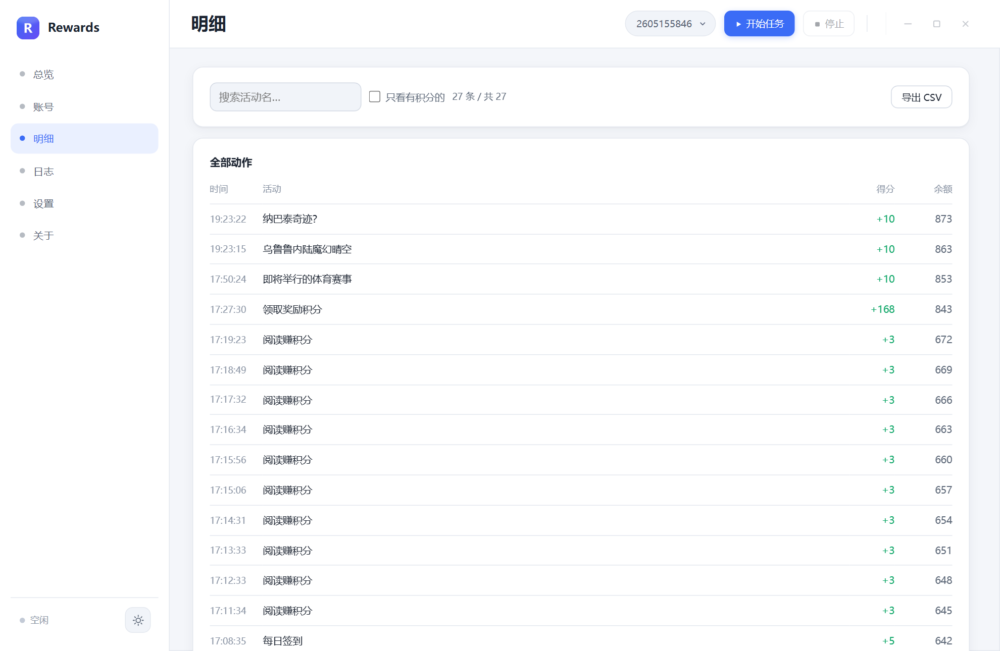

按活动名称搜索，或勾选「只看有积分的」，快速找到得分记录。可导出 CSV，页面底部也能查看异常摘要。

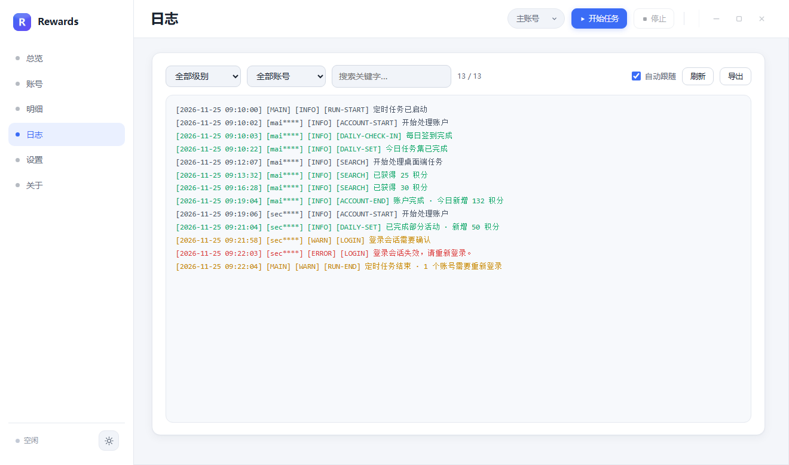

按账号、级别或关键词筛选。排查问题时可暂停自动跟随，也可把日志导出为文本文件。

</details>

### 设置

<details>
<summary>任务、节奏与运行、托盘模式、自动运行</summary>


先选「省心」「标准」或「全都要」，再按需要调整各项任务。点「保存设置」应用选项。

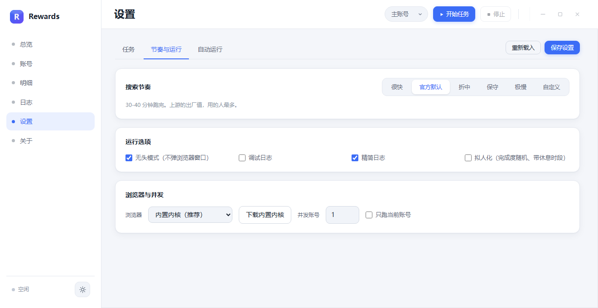

在「节奏与运行」可调整搜索节奏、无头模式、浏览器和并发数。添加账号和重新登录时仍会打开浏览器窗口。在底部「窗口」勾选「关闭窗口后留在托盘」，关窗后当前任务继续运行。

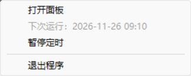

在 Windows 通知区域右键 Rewards 图标，可打开面板、查看下次运行、暂停或恢复定时，以及退出程序。暂停会保留计划，恢复后从下一个有效时间点继续。退出程序会关闭面板并停止当前任务，后续定时由后台守护处理。

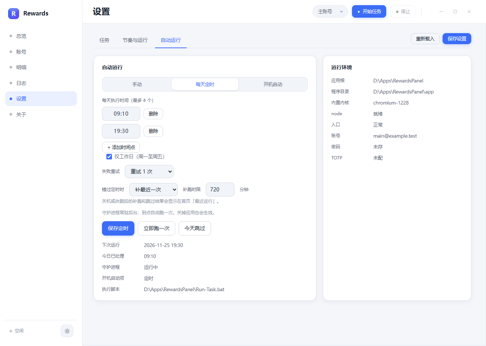

选择手动、每天定时或开机运行。每天定时支持多个时间点、仅工作日和失败重试。关机或休眠错过定时时，可以在时限内补最近一次，也可以直接跳过。处理结果会显示在运行记录里。

</details>

### 关于、检查更新、设置备份与诊断报告

<details>
<summary>版本、更新下载、设置备份与诊断报告</summary>

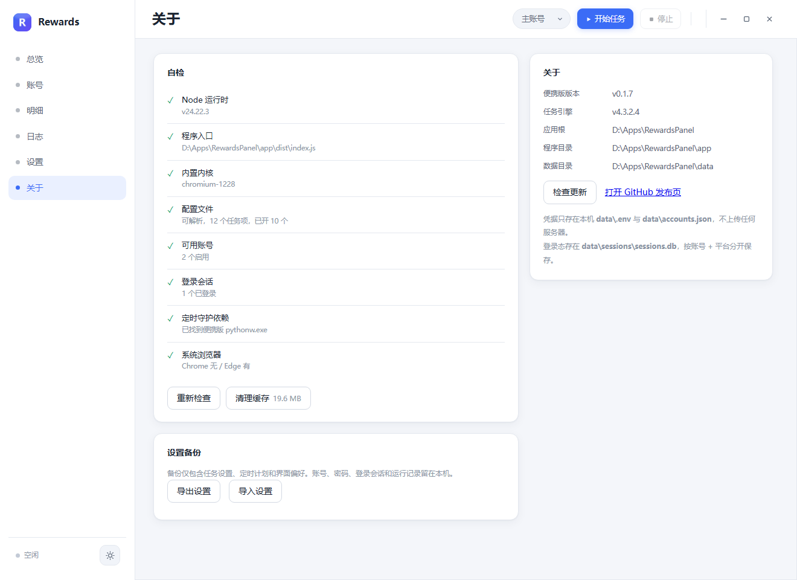

「关于」分别显示便携版与任务引擎的版本。点击「检查更新」可查看新版摘要，下载 Windows x64 ZIP 时会显示进度。SHA-256 校验通过后，可打开下载目录并按提示手动覆盖升级。退出程序后，将新版文件覆盖到原目录，保留 `data/` 中的账号、设置和登录会话。


下载进度和校验结果会显示在「关于」页。校验成功后会出现「打开下载目录」和升级步骤。

「导出设置」保存 JSON 备份，只包含任务设置、定时计划和界面偏好。账号、密码、登录会话和运行记录留在本机。「导入设置」会在确认后覆盖备份中的设置，并按导入后的计划配置自动运行。

启动或登录遇到问题时，可在这里检查 Node、浏览器内核、配置和登录会话，也可以查看应用目录或清理缓存。

反馈问题前，可以在「关于」预览并保存脱敏诊断报告。报告包含版本、启动日志节选和最近一次运行失败摘要，可手动附到 GitHub Issue。


保存前可以核对报告正文。导出文件为 TXT，可手动附到问题反馈。

</details>

### 首次启动和失败处理

<details>
<summary>下载进度、重试与日志</summary>


首次联网启动时，窗口会显示正在下载的组件和百分比。下载和配置完成后会进入面板。

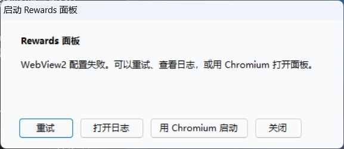

恢复联网后可点击「重试」，也可点击「打开日志」查看失败原因。遇到 WebView2 配置失败时，还能选择用 Chromium 打开面板。

</details>

## 特性

- **总览**：余额、今日新增、动作数、积分曲线、最近动作、今日配额，2.5 秒自动刷新
- **运行记录**：查看近 7 天的任务及各账号的结果，直接打开本次日志、重新登录或单独重试失败账号
- **Windows 异常提醒**：任务失败或账号需要重新登录时发出通知
- **更新下载与设置备份**：查看更新摘要、下载并校验新版 ZIP，以及导入或导出任务设置、定时计划和界面偏好
- **脱敏诊断报告**：预览并保存版本、启动日志节选和最近一次失败摘要
- **账号管理**：多账号增删改、切换当前、单独重登、密钥脱敏显示、批量启用/停用
- **明细**：按活动名搜索、只看有积分的、一键导出 CSV
- **日志**：按级别（错误/警告/成功）和账号过滤、关键字搜索、导出 txt
- **设置**：12 项任务开关、3 档预设（省心 / 标准 / 全都要）、5 档节奏、4 个运行选项
- **定时**：手动 / 每天 / 开机 三种模式；每天最多 4 个时间点；仅工作日；失败自动重试；错过时补跑或跳过
- **首页定时状态**：查看下次运行、暂停状态和守护进程异常，直接恢复定时
- **安全**：账号密码用 Windows DPAPI 加密存盘；本地接口需令牌；密码永不出现在接口响应里
- **体验**：可选关窗留在托盘、深浅色主题、窗口尺寸记忆、单实例、无边框窗口

## 从源码运行

### 环境要求

- Windows 10/11 x64
- Python 3.10+，用于运行桌面面板。[Python 下载](https://www.python.org/downloads/)
- Node.js 24+，用于构建和运行上游脚本。[Node.js 下载](https://nodejs.org/) · [上游版本要求](https://github.com/huaisha1224/Microsoft-Rewards/blob/main/package.json)
- Git 和 Edge WebView2 Runtime。缺少 WebView2 时可单独安装。[WebView2 下载](https://developer.microsoft.com/microsoft-edge/webview2/#download-section)

### 1. 安装面板依赖

在 Rewards Panel 仓库根目录打开 PowerShell。

```powershell
python -m pip install -r requirements.txt
```

### 2. 准备上游脚本和 Chromium

上游源码、构建产物和 Chromium 需要在本机准备。以下命令适用于首次安装，从 Rewards Panel 仓库根目录执行。

```powershell
git clone https://github.com/huaisha1224/Microsoft-Rewards.git app
$rewardsBrowserPath = Join-Path (Get-Location).Path 'browser'
Copy-Item -LiteralPath (Get-Command node.exe -CommandType Application).Source -Destination .\app\node.exe

Push-Location .\app
npm.cmd install
npm.cmd run build
$env:PLAYWRIGHT_BROWSERS_PATH = $rewardsBrowserPath
npm.cmd run install:browser
Pop-Location
```

面板和定时调度从 `app/node.exe` 运行 `app/dist/index.js`，登录窗口使用安装到 `browser/` 的 Chromium。

### 3. 启动面板并添加账号

在仓库根目录运行以下命令，或双击 `Rewards.bat`。

```powershell
python desktop.py
```

打开「账号 → 添加账号」，输入微软账号邮箱，在弹出的窗口完成登录。登录会话保存到本机 `data/sessions/`，账号配置由面板写入 `data/`。回到面板后，可在顶栏启动任务，或到「设置 → 自动运行」配置定时。

## 目录结构

```
RewardsApp/
├─ desktop.py            无边框窗口外壳：单实例、几何记忆、图标、快捷方式
├─ scheduler.py          定时守护（独立进程，无窗口常驻）
├─ Rewards.bat           Windows 启动器
├─ Run-Task.bat          静默跑一次任务（开机自启脚本会调它）
├─ panel/
│  ├─ server.py          本地 HTTP 接口 + 静态服务（127.0.0.1:8765）
│  ├─ accounts.py        账号存取、DPAPI 加解密、生成 .env
│  ├─ schedule.py        定时设置：模式、多时间点、跳过今天、开机启动项
│  └─ index.html         全部界面（单文件，无框架无构建）
├─ assets/               图标（png/ico）与生成脚本
├─ docs/                 README 截图
├─ app/                  ← 上游项目，自行放置，不入库
├─ browser/              ← Patchright Chromium，便携版首次启动自动下载，不入库
└─ data/                 ← 运行时数据，不入库
   ├─ .env               账号配置（工具读取）
   ├─ accounts.json      账号表（密码字段为 DPAPI 密文）
   ├─ sessions/          登录会话（SQLite）
   ├─ config.json        任务与节奏配置
   ├─ schedule.json      定时设置
   └─ prefs.json         界面偏好（主题、窗口尺寸）
```

## 工作原理

`desktop.py` 启动本地服务（默认 `127.0.0.1:8765`），再打开 pywebview 桌面窗口。页面定期读取运行状态，面板解析 `app/logs/` 下的任务日志，展示余额、动作与错误。

点击「开始任务」时，面板用独立 Node.js 进程运行 `app/dist/index.js`，并提供账号配置和本地数据目录。启用托盘模式后，关窗会隐藏面板并保留当前任务。退出程序时会尝试停止正在运行的任务。每日定时由后台守护进程触发，可在桌面窗口关闭时运行。

## 定时与开机自启

三种模式（设置 → 自动运行）：

| 模式 | 机制 |
|---|---|
| 手动 | 只在你点「开始任务」时跑 |
| 每天 | 写入启动项拉起 `scheduler.py` 常驻守护，到点触发 |
| 开机 | 写入启动项 `RewardsBoot.bat`，登录后约 1 分钟跑一次 |

- 每天模式支持 **最多 4 个时间点**、**仅工作日**、**失败重试**（触发后 3 分钟内无日志输出则重跑，可设 0-2 次）
- 错过定时后可选择补最近一次或直接跳过。补跑时限为 1–1440 分钟，默认 720 分钟。较早的时间点和超出时限的任务会记为跳过，运行记录会显示原定时间和原因
- 「今天跳过」仅影响当天，后续日期按计划运行
- 启动项写在 `%APPDATA%\Microsoft\Windows\Start Menu\Programs\Startup`，不写注册表，不需要管理员权限

## 安全设计

| 措施 | 说明 |
|---|---|
| 密码存储 | `data/accounts.json` 中 `password` / `totp` / `proxy_pass` 用 DPAPI 加密（`enc:` 前缀），绑定当前 Windows 用户，换机器解不开 |
| 接口鉴权 | 首次启动生成 `data/.api-token`，无令牌访问 `/api/*` 返回 403；页面用 `?k=` 首次进入后落 cookie |
| 监听范围 | 只绑定 `127.0.0.1`，不接受外部连接 |
| 响应脱敏 | 账号接口用 `hasPassword` 等字段表示凭据是否存在，响应中不包含密码正文 |
| `.env` | 由 `accounts.json` 生成，供上游脚本读取，因此是明文——只放在本机 `data/` 下 |

## 本地接口

便于脚本化或自己做前端。全部需令牌。

| 方法 | 路径 | 作用 |
|---|---|---|
| GET | `/api/status` | 运行状态、余额、动作、错误、缓存体积 |
| GET | `/api/actions?limit=800` | 全量动作记录 |
| GET/POST | `/api/config` `/api/config/batch` | 读取 / 批量保存任务配置 |
| GET | `/api/accounts` | 账号列表（脱敏） |
| POST | `/api/accounts/*` | `add` `update` `remove` `switch` `toggle` `bulk` |
| GET/POST | `/api/schedule` | 读取 / 保存定时；另有 `/api/schedule/skip` |
| GET | `/api/logs?lines=800` | 日志（含级别标记） |
| POST | `/api/run` `/api/stop` | 开始 / 停止任务，可带 `{"only":"邮箱"}` 只跑一个账号 |
| GET | `/api/selftest` | 8 项环境自检 |
| POST | `/api/cache/clean` | 清理登录缓存 |
| POST | `/api/window/close` | 关闭窗口（桌面模式下可用） |

## 常见问题

**窗口怎么拖动**：按住**顶栏空白处**拖（标题那一行）。页面其它区域不响应拖动，避免翻日志、选文字时把窗口带跑；双击顶栏最大化/还原。

**窗口启动失败**：在仓库根目录执行 `python desktop.py` 查看终端报错，并确认 Python 依赖和 WebView2 已安装。

**任务栏右键显示 “Python”**：需要 `pywin32`。程序会自动在开始菜单建带 AUMID 的快捷方式，建好后取消固定再重新固定即可。

**窗口越开越小**：已修（客户区/外框差值补偿）。若仍有偏差，删掉 `data/prefs.json` 里的 `win` 字段重开一次。

**提示“已有任务在运行”**：可能是上次异常退出留下的进程。看 `data/task.pid`，或任务管理器结束 `node.exe`。

**登录缓存占地大**：关于页有「清理缓存」按钮。

## 开发

- 后端零依赖（只用标准库），改完 `server.py` 重启即可
- 前端是单文件 `panel/index.html`，无构建步骤，改完刷新页面
- 调试接口示例：

```powershell
$k = Get-Content data\.api-token -Raw
curl "http://127.0.0.1:8765/api/status?k=$k"
```

## 许可

Rewards 面板采用 MIT 许可。[本项目许可证](LICENSE)

运行时依赖的许可声明见第三方声明。本项目随附上游 MIT 许可文本。[许可原文副本](docs/upstream-MIT-LICENSE.txt) · [第三方声明](THIRD-PARTY-NOTICES.md)

## 免责

本项目仅用于个人学习与自用自动化。使用前请自行确认符合微软奖励计划的服务条款；账号被限制、积分被清零等后果由使用者自行承担。作者不对任何间接损失负责。
